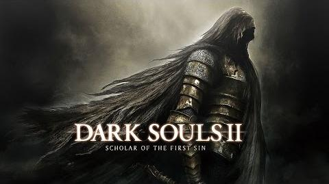

# Dark Souls II: Scholar of the First Sin — Nintendo Switch

<p align="center">
  
</p>

[Русский](README.md) · [Download the port](https://github.com/KostinKD/ds2scholar-nx/releases/download/v1.10.0-access1/ds2scholar-nx-1.10.0-access1-home.zip) · [YouTube video](https://youtu.be/Z7behKeTOnI) · [Maximum FPS](#maximum-fps)

Unofficial port of **Xbox 360 SotFS** for Switch. This guide installs the
**prebuilt player package: you do not need to compile an NRO or install PGO to play**.
This is experimental; a full playthrough and all DLC areas remain unverified.

## Before you start

- A Switch with **Atmosphère, hbmenu and DBI already set up**. Setting these up
  is outside this guide; the port does not run on an unmodified stock Switch.
- About **8 GB** free on SD and a way to connect the card to your PC.
- **Your own Xbox 360 SotFS Games on Demand (GoD) copy and Compatibility Pack 4**.
  PC, PS3 and later-console editions cannot be used. Game data is not included.
- A Windows PC with **Python 3.10+** to extract your game.
  Check that `python --version` works in PowerShell.
  If the command is not found, install Python with PATH enabled and open a new PowerShell window.

## 1. Download the player package

**[Download ds2scholar-nx-1.10.0-access1-home.zip](https://github.com/KostinKD/ds2scholar-nx/releases/download/v1.10.0-access1/ds2scholar-nx-1.10.0-access1-home.zip)**

Alternatively, open [Releases → v1.10.0-access1](https://github.com/KostinKD/ds2scholar-nx/releases/tag/v1.10.0-access1), expand **Assets**
and choose that file.

**Do not use Code → Download ZIP, Source code or the PGO ZIP to install the game.**
Those are developer files. The player ZIP already contains `ds2.nro`, the config,
both shader files, the HOME launcher installer and extraction tools.
If it is unavailable, see [building your own player ZIP](docs/build-player-zip.md#english-summary).

## 2. Copy the port to SD

1. Extract the downloaded ZIP on your PC.
2. Fully power off the Switch before removing SD, then connect the card to your PC.
3. Copy the ZIP's **`switch` folder to the SD root**, merging with an existing `switch` folder if needed.

The result must be **`SD:/switch/ds2scholar-nx/ds2.nro`**,
not `SD:/switch/switch/...` or another nested folder named after the ZIP.

## 3. Add your own game

Open PowerShell **inside the extracted player ZIP folder on your PC**;
you should see `extract-tools/` and `switch/` there. In the examples, replace
`E:` with your SD drive letter and replace `<...>` with the real path to your file.

Extract your GoD copy (about 6 GB):

```powershell
python extract-tools/god_extract.py "<full path to your GoD header file>" -o "E:/switch/ds2scholar-nx/game_root"
```

The header is normally under `465307E4/00007000/`. Keep its matching
**`<header name>.data` folder** with `Data0000`, `Data0001`, etc. beside it.
After extraction, check that **`E:/switch/ds2scholar-nx/game_root/default.xex` exists**.

Now extract **Compatibility Pack 4** (about 1.2 GB):

```powershell
python extract-tools/stfs_extract.py "<full path to your Compatibility Pack 4 file>" "E:/switch/ds2scholar-nx/ds2/0000000000000000/465307E4/00000002/D4B91B6B4DA1509C280F56F77B09203DE7D39AE646"
```

The package is normally under `465307E4/00000002/` and named
`D4B91B6B4DA1509C280F56F77B09203DE7D39AE646`.
**SotFS will not start without Compatibility Pack 4.** Keep the destination directory exactly as shown.

## 4. Install the launcher and start the game

1. Safely eject SD from the PC, put it back in the Switch and boot Atmosphère.
2. Open hbmenu by holding **R** while launching an installed game, then start **DBI**.
3. Use DBI to install **`switch/ds2scholar-nx/ds2scholar-forwarder.nsp`** from SD.
   Copying the NSP to SD alone does not install it.
4. Return to HOME and start the new **DS2** tile.
5. Choose your Switch user. Keep choosing **the same user** for your saves and online name.

**Do not delete the NRO, shaders or game folder after installing the NSP.**
The HOME tile launches that NRO from SD; it does not contain the whole game.
If an old cover remains after reinstalling, fully restart the console/Atmosphère.
Sleep is not a full restart.

Your SD layout should be:

```text
switch/ds2scholar-nx/
  ds2.nro
  ds2.toml
  sa2_shaders.mesp
  sa2_shaders.mesp.idx
  ds2scholar-forwarder.nsp
  game_root/default.xex
  game_root/...                         # the rest of your extracted game
  ds2/0000000000000000/465307E4/00000002/
    D4B91B6B4DA1509C280F56F77B09203DE7D39AE646/...
```

## Maximum FPS

First check that the game starts with the supplied config: it targets steadier
**30 FPS**, dynamic 720p/ 540p and FSR 1.

Recommended handheld maximum-FPS profile:
**FSR 1 + fixed 540p + the 30 FPS cap disabled**.

| In-game shortcut | Action |
|---|---|
| L + R + Minus | Toggle the 30 FPS cap |
| L + R + Plus | Toggle dynamic resolution |
| L + R + right-stick click | Cycle dynamic / 720p / 540p |
| L + R + left-stick click | Cycle the upscaler — select FSR 1 |

Check the on-screen notification: choose fixed 540p, FSR 1 and cap off.
To keep this selection on the next launch, close the game, back up `ds2.toml`
and **edit existing keys**, avoiding duplicates:

```toml
present_effect = "fsr"
ds2_frame_cap_30 = false
ds2_dynamic_resolution = false
sa2_render_height_handheld = 540
ds2_vpos_render_scale = true
```

Restart the game. To return to steadier 30 FPS, set `ds2_frame_cap_30` and
`ds2_dynamic_resolution` back to `true` and the render height to `720`.
Earlier static Majula measurements of about 40 FPS at 540p used handheld OLED
at CPU 1785 / GPU 921.6 / RAM 2133 MHz. The port does not set those frequencies itself.
This is not a promise for every area or stock clocks. Stable 60 FPS and an FPS
advantage of FSR 1 over other upscalers have not been demonstrated.

## Saves, updates and controls

- Keep **`game_root/` and `ds2/`** when updating. `ds2/` contains saves and the
  compatibility pack. Back up your `ds2.toml`, compare it with the new config
  and carry over your settings. Install an updated NSP over the old one with DBI.
- Buttons follow Switch letters: **A confirms; B cancels/rolls**.
- Online uses the project server and depends on its availability.
  Continue choosing the same Switch user for your saves and name.

## Troubleshooting

- **No `ds2.nro` in your download:** you likely downloaded source code. Get the player ZIP from release Assets.
- **No HOME tile:** install the NSP with DBI; copying it to SD is not enough.
- **Launch stopped working after deleting files:** restore the NRO and full port folder on SD.
- **The game does not start:** check `game_root/default.xex`, Compatibility Pack 4 and the folder layout above.
- When starting the NRO directly from hbmenu, use **R + an installed game (title override)**.
  Album mode does not provide enough memory.

For a bug report, include the latest `logs/ds2_NNN.log` from the port folder,
version, location, steps and handheld/TV mode. Full playthrough, all DLC,
3–4-player sessions and network recovery after sleep remain unverified.
A post-summon PC crash remains unresolved; the same crash is unconfirmed on Switch.

## If the player ZIP is unavailable

You can [compile the NRO and create your own player ZIP](docs/build-player-zip.md#english-summary).
This requires development tools and your own game, and is separate from the
normal installation above.

<details>
<summary>For developers: build an NRO with PGO</summary>

## Build an NRO with PGO


Use this path to **compile `ds2.nro` from source**. The player installation above
uses an NRO that is already built.

1. **Prepare Windows dependencies:** Python, LLVM/Clang 20, Visual Studio C++ tools,
   CMake/Ninja, MSYS2, devkitPro/libnx with **devkitA64 GCC 16.1.0**, and a compatible
   **Mesa/NVK SDK for Switch**. Set your `SA2_LLVM`, `SA2_VSDIR`, `DEVKITPRO` and
   `NVK_SDK` as described in the [environment instructions](docs/clean-build.md).
   **The patched Mesa/NVK SDK is not included.** Compilation requires it; setup
   on a fresh OS has not been validated end to end.
2. **Clone the repository** and extract your own game to `assets/game_root/`.
   The code generator needs `assets/game_root/default.xex`. Use a Git clone, not the Source ZIP.

   ```powershell
   git clone https://github.com/KostinKD/ds2scholar-nx.git
   cd ds2scholar-nx
   python tools/god_extract.py "<path to your GoD header>" -o assets/game_root
   ```

3. **Install PGO before code generation.** Download
   `ds2scholar-nx-pgo-v4-1.10.0-access1.zip` from the [release](https://github.com/KostinKD/ds2scholar-nx/releases/tag/v1.10.0-access1)
   into `out/downloads/`, then run from the clone root:

   ```powershell
   tools/win/run.ps1 logs/pgo_install.log "python -I tools/pgo_bundle.py install out/downloads/ds2scholar-nx-pgo-v4-1.10.0-access1.zip"
   ```

4. **Compile the NRO at this step:**

   ```powershell
   tools/win/rebuild_switch.ps1
   ```

   The script builds the host generator and glslang, runs optimised code generation,
   compiles the Switch executable with **PGO + LTO**, and checks the profile and ELF/NRO.
   It uses 5 jobs by default; a full build can take about an hour.
5. **Output:** `out/nx_pgo/ds2.nro`.
   Replace `switch/ds2scholar-nx/ds2.nro` on an SD with the player package already
   installed. The config, both shader files, your game and Compatibility Pack 4
   are also required. See [installation](#4-install-the-launcher-and-start-the-game).

The PGO ZIP is a build input, not an executable. You do not need to record your
own gameplay profile to use it. Details: [rebuild options](docs/rebuild.md),
[PGO](docs/pgo-profile.md), [low-level commands and PC builds](docs/workflow.md).

</details>

Port code: [GPL-3.0](LICENSE). Credits and component licenses:
[THIRD_PARTY_NOTICES.md](THIRD_PARTY_NOTICES.md). Game materials belong to their
respective rights holders. This project is unaffiliated with FromSoftware, Bandai Namco, Nintendo or Microsoft.
