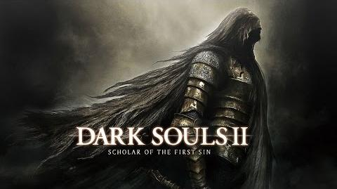

# Dark Souls II: Scholar of the First Sin — Nintendo Switch

<p align="center">
  
</p>

[English](README.en.md) · [Полная инструкция](docs/players/README.md#русский) · [Настройки FPS](#максимальный-fps)

Неофициальный порт **Xbox 360-версии SotFS** на Switch. Работают запуск из HOME,
сохранения, управление и онлайн через сервер проекта. **Экспериментальный релиз**:
полное прохождение и все DLC ещё не проверены.

## Быстрый запуск

Нужны **Switch с Atmosphère, hbmenu и DBI**, около **8 ГБ** на SD,
своя Xbox 360-копия SotFS в формате **GoD + Compatibility Pack 4** и PC с Python 3.10+.

1. Распакуйте готовый пакет порта и скопируйте папку `switch` в корень SD.
2. Распакуйте свою игру и Compatibility Pack 4 по [инструкции ниже](#установка-на-switch).
3. Установите `ds2scholar-forwarder.nsp` через **DBI**, запустите **DS2 из HOME**
   и выберите прежнего пользователя Switch.

Оставьте NRO и папку игры на SD. При обновлении сохраняйте `game_root/` и `ds2/`.
Файлы игры не входят в пакет; архив исходников сам по себе не готов к запуску.

| Что выбрать | Настройки |
|---|---|
| Более ровные 30 FPS | Готовый конфиг: лимит 30 FPS, динамические 720p/540p, FSR 1 |
| Максимальный FPS | **FSR 1 + фиксированные 540p + отключённый лимит** — [как включить](#максимальный-fps) |

Основные тесты: OLED, портатив, CPU 1785 / GPU 921,6 / RAM 2133 МГц.
В тяжёлых сценах возможны просадки; результат на штатных частотах отличается.

## Установка на Switch

Нужны Switch с Atmosphère и hbmenu, около **8 ГБ** свободного места на SD и PC
с Python 3.10+ для распаковки. Игра должна быть в формате Xbox 360 Games on Demand
с **Compatibility Pack 4** — без него SotFS не запускается.

Следующие шаги рассчитаны на готовый пакет порта. Исходники из GitHub сами по
себе таким пакетом не являются. Пакет содержит NRO `1.10.0-access1`, конфиг,
два файла шейдеров и `ds2scholar-forwarder.nsp` в `switch/ds2scholar-nx/`,
а также `extract-tools` и лицензии. Файлов игры, ключей и сохранений в нём нет.

1. Скопируйте папку `switch` из пакета в корень SD.
2. Распакуйте свою игру (запускайте из каталога пакета):

   ```powershell
   python extract-tools/god_extract.py "<ваши файлы>\465307E4\00007000\<файл GoD>" -o "<SD>\switch\ds2scholar-nx\game_root"
   ```

   Папка `<файл GoD>.data` должна находиться рядом с заголовочным файлом GoD.
3. Распакуйте свой Compatibility Pack 4:

   ```powershell
   python extract-tools/stfs_extract.py "<ваши файлы>\465307E4\00000002\D4B91B6B4DA1509C280F56F77B09203DE7D39AE646" "<SD>\switch\ds2scholar-nx\ds2\0000000000000000\465307E4\00000002\D4B91B6B4DA1509C280F56F77B09203DE7D39AE646"
   ```

4. Установите `switch/ds2scholar-nx/ds2scholar-forwarder.nsp` через **DBI**.
5. Запустите плитку **DS2** в HOME и выберите **того же пользователя Switch**,
   которым играли раньше: от него зависят сохранения и онлайн-личность.

Forwarder запускает NRO с SD: после установки NSP оставьте `ds2.nro` и всю
папку игры на карте. Альтернатива — hbmenu через установленную игру с зажатой
**R** (title override); доступ к четвёртому ядру зависит от загрузчика.
Запуск hbmenu через Album не даёт достаточно памяти.
Если после установки NSP остаётся старая иконка, полностью перезапустите
консоль/Atmosphère. Владелец подтвердил отображение выбранной обложки
после переустановки NSP и полного перезапуска.

Основные файлы на SD:

```text
switch/ds2scholar-nx/
  ds2.nro
  ds2.toml
  sa2_shaders.mesp
  sa2_shaders.mesp.idx
  ds2scholar-forwarder.nsp     # установщик плитки HOME
  game_root/                  # распакованная игра, включая default.xex
  ds2/                        # данные пользователей и пакет совместимости
    0000000000000000/465307E4/00000002/
      D4B91B6B4DA1509C280F56F77B09203DE7D39AE646/
```

При обновлении сохраните `game_root/` и `ds2/`: в `ds2/` находятся сохранения
и пакет совместимости. Сделайте резервную копию своего `ds2.toml`, сравните
его с новым конфигом и перенесите нужные параметры. Не заменяйте свои настройки
вслепую. Обновлённый NSP устанавливается поверх прежнего через DBI.
Для распаковки непосредственно из репозитория используйте скрипты в `tools/`
вместо `extract-tools/`. Полная инструкция — [руководство игрока](docs/players/README.md).

## Управление и настройки

По умолчанию кнопки соответствуют **буквам Switch**: A — подтверждение,
B — отмена/перекат. Это задаёт `input_xbox_layout = false` в `ds2.toml`.

Для ТВ режим проверен менее полно; поведение разрешения и быстродействие
отличаются от портативного режима. Остальные параметры — в `ds2.toml`.

## Максимальный FPS

Рекомендуемый профиль в портативном режиме: **FSR 1 + фиксированные 540p +
отключённый лимит 30 fps**. Запускайте готовую сборку с плитки DS2 в HOME.

| Комбинация | Действие |
|---|---|
| L + R + Минус | Включить/выключить ограничение 30 fps |
| L + R + Плюс | Включить/выключить динамическое разрешение |
| L + R + нажатие правого стика | Динамическое / фиксированные 720p / фиксированные 540p |
| L + R + нажатие левого стика | Переключить апскейлер — выберите FSR 1 |

Закройте игру, сохраните копию `ds2.toml` и измените существующие ключи
(отсутствующие добавьте, без дубликатов):

```toml
present_effect = "fsr"
ds2_frame_cap_30 = false
ds2_dynamic_resolution = false
sa2_render_height_handheld = 540
ds2_vpos_render_scale = true
```

Перезапустите игру. Текущий режим отображается в уведомлении.
Для более ровных 30 fps верните лимит и динамическое разрешение, а высоту — 720.
Прежние замеры около 40 fps в статичной Маджуле при 540p выполнены на OLED
с CPU 1785 / GPU 921,6 / RAM 2133 МГц; это не обещание такого FPS во всей игре.
Отдельное преимущество FSR 1 над другими апскейлерами по FPS не измерялось.
Подробности — [максимальный FPS](docs/players/README.md#максимальный-fps).

## Онлайн

Публичный конфиг использует `ds2scholar.download` с запасным IP.
Проброс портов для серверного реле не требуется. Доступность онлайна зависит
от сервера проекта. Это отдельный сервис, не официальные серверы игры.

Онлайн-личность привязана к пользователю Switch. Ник берётся из профиля,
кириллица транслитерируется; при неподходящем имени используется `Player-XXXX`.
Своё имя можно задать в `ds2.toml`:

```toml
net_profile_name = "MyName"
```

Допустимы латинские буквы, цифры, пробел и `_ - .`, до 15 символов.
При переходе на профиль пользователя старые сохранения копируются один раз,
исходная папка остаётся.

Проверка серверного доступа по ключу консоли (`access1`) ещё не завершена.
Метка версии NRO сама по себе не подтверждает работу этого режима.

## Сборка и разработка

Для PGO и упаковки релиза используйте полный Git-клон с историей.
Архив исходников — снимок файлов; он не содержит Git-ревизию, нужную установщику PGO.

Повторная PGO+LTO-сборка одной командой: `tools/win/rebuild_switch.ps1`.
Первоначальная настройка и параметры — [повторная сборка](docs/rebuild.md).

Текущая рабочая среда — Windows, PowerShell, Python 3.12, LLVM/Clang 20,
CMake/Ninja, Visual Studio C++ tools; для Switch — devkitPro/devkitA64, libnx,
MSYS2 и отдельная сборка Mesa/NVK для Horizon.

**Switch-сборка из чистого клона проверена 3 ноября 2026 года** после добавления
отсутствовавших заголовков FFmpeg в CMake overlay: host-генератор, glslang,
optimised-кодоген, NRO с LTO без PGO и проверка ELF/NRO прошли.
Использовались установленный devkitPro и внешний Mesa/NVK; чистая ОС,
полная PC-сборка и запуск нового NRO на консоли в этот прогон не входят.
Команды, контрольные суммы и ограничения — в [отчёте](docs/clean-build.md).
Ниже — команды для подготовленной среды; полная последовательность —
в [docs/workflow.md](docs/workflow.md).

```powershell
# Укажите свои пути к LLVM и Visual Studio.
$env:SA2_LLVM = 'G:\Program Files\LLVM'
$env:SA2_VSDIR = 'G:\Program Files\VisualStudio'
. .\tools\win\env.ps1

# Вход: своя распакованная игра в assets/game_root/default.xex.
# Предварительно нужен собранный host-генератор ReXGlue (см. workflow).
tools\win\run.ps1 logs\codegen.log "powershell -NoProfile -ExecutionPolicy Bypass -File tools\codegen.ps1"

# PC: предварительно подготовить glslang и пакет игровых шейдеров (см. workflow).
tools\win\run.ps1 logs\pc_configure.log "cmake --preset win-pc -S app"
tools\win\run.ps1 logs\pc_build.log "cmake --build out/pc --target ds2"

# Switch: кодоген и внешние зависимости должны быть подготовлены.
tools\win\run.ps1 logs\switch_build.log "powershell -NoProfile -ExecutionPolicy Bypass -File tools\win\build_switch.ps1 -Jobs 5"
```

Обычная Switch-сборка выдаёт `out/nx/ds2.nro`. Проверенная производительная
конфигурация использует optimised-кодоген, LTO и PGO в `out/nx_pgo`; PGO-профиль
не хранится в Git. Профиль владельца можно установить отдельным пакетом,
включающим таблицу распределения функций перед кодогеном:
[PGO v4](docs/pgo-profile.md). Отдельный PGO ZIP нужен только для сборки;
для игры он не требуется. Сбор своего профиля описан в workflow. Полная сборка
Switch может занимать около часа; увеличение числа задач может исчерпать память.

Тесты и сравнения: `tools/win/boot_test.ps1`, `tools/win/native_ab.ps1` и
`tools/check_switch_build.py` — см. [рабочие рецепты](docs/workflow.md).
Публичный пакет формирует `tools/win/package_switch.ps1 -Public` из готовых NRO
и пакета шейдеров; игровых данных он не включает.

## Известные ограничения и сообщения об ошибках

- На PC после завершения призыва также повторилось падение с чтением нулевого
  адреса. Причина не установлена; это не подтверждённое падение Switch.
- При предупреждении о повторных разрывах мультиплеера игра требует использовать
  Bone of Order («Кость порядка»). Доступность предмета зависит от сохранения;
  серверные настройки эту игровую блокировку не снимают.
- Кооператив с 3–4 участниками и восстановление онлайна после сна ещё не проверены.
- Наблюдалось мерцание освещения/чёрный квадрат в углу кузницы Макдаффа.
- Полное прохождение, все DLC-локации и длительная стабильность не подтверждены.
- deko3d — экспериментальное направление; основной проверенный путь — Vulkan/NVK.

Логи Switch: `sdmc:/switch/ds2scholar-nx/logs/ds2_NNN.log`.
PC: `out/pc/logs/`. При сообщении об ошибке укажите версию из hbmenu, локацию,
действия перед проблемой, портативный/ТВ режим и приложите последний лог.
Перед публикацией лога проверьте его на персональные данные и сетевые идентификаторы.

## Документация и лицензия

- [Сборка и рабочие команды](docs/workflow.md)
- [Инструкция игрока, русский / English](docs/players/README.md)
- [Подготовленный пакет релиза и проверки](docs/release-ready.md)
- [Собственный HOME-forwarder](docs/forwarder.md)
- [План deko3d](docs/deko3d.md)
- [Авторы, происхождение кода и сторонние компоненты](THIRD_PARTY_NOTICES.md)

Код порта распространяется под [GPL-3.0](LICENSE); SDK и сторонние компоненты
сохраняют собственные лицензии. Проект основан на ds2-nx и работе авторов
sa2-nx, masseffect-nx, nfsmw-nx, ReXGlue/Xenia, XenosRecomp и Mesa/NVK.
Полный список благодарностей и лицензий — в THIRD_PARTY_NOTICES.md.

Dark Souls II и оригинальные материалы игры принадлежат соответствующим
правообладателям. Проект не связан с FromSoftware, Bandai Namco, Nintendo
или Microsoft и не одобрен ими.
